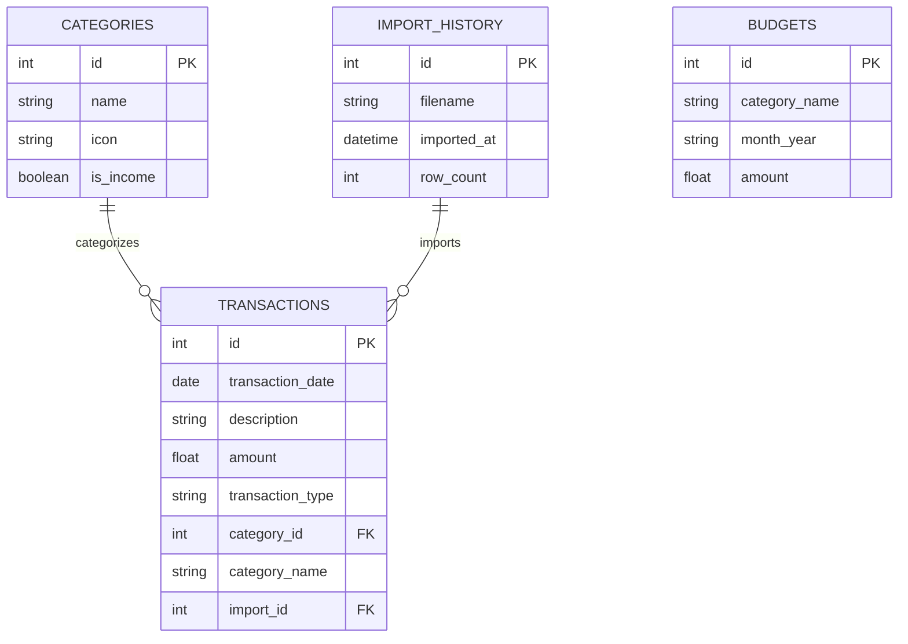

# Database Design

SpendSense uses a relational database design. It supports both **SQLite** (for easy local setup) and **MySQL** (for production environments).

## Schema Diagram (Conceptual)

## Normalization Strategy
- **Categories**: The `categories` table prevents spelling mistakes and allows us to store metadata (like icons or the `is_income` flag) in one place.
- **Transactions**: The core fact table. It references categories and import history.
- **Budgets**: Stored independently by `(category_name, month_year)` with a UNIQUE constraint to prevent overlapping budgets.

## Indexing
Indexes are critical for dashboard performance. We index:
1. `transaction_date` in `transactions` (speeds up date range filters)
2. `category_name` in `transactions` (speeds up category groupings)
3. `month_year` in `budgets` (speeds up monthly budget lookups)
